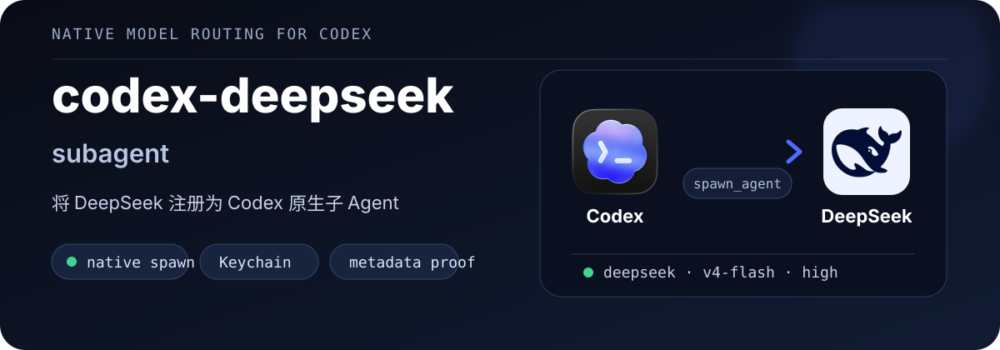
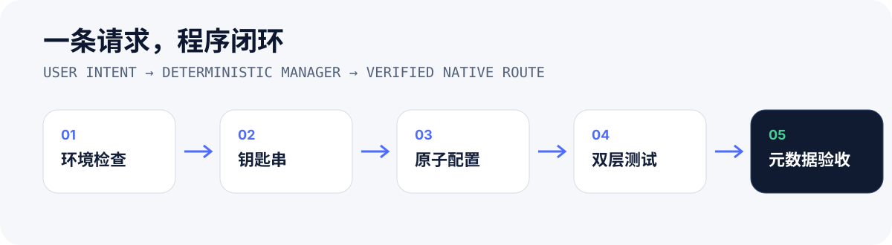

<p align="center">
  
</p>

配置和维护桌面应用中的 DeepSeek Flash 子 Agent，支持检查路由、修复、停用和卸载。

## 当前兼容性限制

**本仓库不是当前 Codex 跨 Provider 原生子 Agent 的通用接入方案。** 当前 [Codex 官方规则](https://learn.chatgpt.com/docs/agent-configuration/subagents)明确规定，自定义子 Agent 继承父 Agent 的 Provider，角色文件中的 `model_provider` 不能覆盖它。本工具保留历史运行时的配置与验收流程；升级模型名、禁用 v2 或设置 v1 均不能绕过该限制。

仅支持并默认使用 `deepseek-flash`，目前对应 DeepSeek-V4.1-Flash-1017。旧名称 `deepseek-v4-flash` 只作为迁移别名，修复后统一写入新名称。

`configured` 和 `--skip-live-test` 仅表示文件已配置，不表示原生路由可用。`ready` 必须经过真实子线程路由和返回口令的双重验收。遇到 `native_provider_inherited` 时停止使用本方案；不要把 DeepSeek 直连成功当作原生子 Agent 已生效。`setup` / `repair` 验收失败会沿用原有备份恢复文件。

## 适用范围

这个 Skill 只用于：

- 首次配置、状态检查和实时测试；
- 父模型变化后的修复；
- 停用或卸载 DeepSeek 配置。

普通的编码、探索、实现、评审和验证任务不应重复运行配置流程。

<p align="center">
  
</p>

## 快速开始

要求：macOS 或 Windows、Python 3.11+、ChatGPT/Codex 桌面应用，以及 DeepSeek 官方 API Key。

1. 全局安装 Skill：

```bash
npx skills add alanleng7/codex-deepseek-subagent -g -y
```

2. 重启桌面应用并新建任务，让 Skill 生效。

3. 在新任务中发出配置请求：

```text
帮我把 DeepSeek 配置成 Codex 的原生子 Agent。
```

4. 默认使用 `deepseek-flash`，无需选择模型；本仓库只维护 Flash 集成。

5. Agent 会在缺少凭据时展示本机配置页，再通过包装器接入运行时原生凭据并验收；不会索要聊天中的 API Key。实时验收会消耗父模型及 DeepSeek 的额度。

6. 看到 `status: ready` 后，再重启桌面应用并新建任务。此后可直接说：

```text
用 DeepSeek 子 Agent 检查这个项目。
```

配置成功后，角色文件位于 `$CODEX_HOME/agents/DeepSeek.toml`；默认 `CODEX_HOME` 为 `~/.codex`。

## 使用与兼容性

- 日常任务只能由主 Agent 直接调用 `spawn_agent(agent_type="DeepSeek", fork_turns="none")`。
- 配置与验收只使用桌面应用内置运行时；版本仅作诊断，实际能力以真实派发结果为准。
- 父模型从当前配置读取；切换父模型后运行 `repair`。
- `repair` 默认保留 Flash 配置，并将受管旧名称迁移为 `deepseek-flash` 后重新验收。
- 本集成只派发文本。模型本身的图像能力不代表此历史跨 Provider 路由已通过视觉验收，图片、视频、截图仍由父 Agent 先整理成文字。
- 当前工具若不认识 `DeepSeek` 角色，只提示用户打开新任务或重启 Codex；不得用脚本或 `codex exec` 代做用户任务。

v1/v2 路由原因、配置位置和回滚规则见 [兼容性说明](codex-deepseek-subagent/references/compatibility.md)。

## 管理命令

管理命令由 Skill 按需调用：

macOS：

```bash
python3 codex-deepseek-subagent/scripts/codex_deepseek.py status --json
node codex-deepseek-subagent/scripts/credential-ui/src/profile.ts run default -- python3 codex-deepseek-subagent/scripts/codex_deepseek.py setup --model deepseek-flash --api-key-env --json
python3 codex-deepseek-subagent/scripts/codex_deepseek.py test --json
python3 codex-deepseek-subagent/scripts/codex_deepseek.py repair --model deepseek-flash --json
python3 codex-deepseek-subagent/scripts/codex_deepseek.py disable --json
python3 codex-deepseek-subagent/scripts/codex_deepseek.py uninstall --json
```

Windows：

```powershell
py -3 codex-deepseek-subagent\scripts\codex_deepseek.py status --json
node codex-deepseek-subagent/scripts/credential-ui/src/profile.ts run default -- py -3 codex-deepseek-subagent/scripts/codex_deepseek.py setup --model deepseek-flash --api-key-env --json
py -3 codex-deepseek-subagent\scripts\codex_deepseek.py test --json
py -3 codex-deepseek-subagent\scripts\codex_deepseek.py repair --model deepseek-flash --json
py -3 codex-deepseek-subagent\scripts\codex_deepseek.py disable --json
py -3 codex-deepseek-subagent\scripts\codex_deepseek.py uninstall --json
```

管理程序会自动寻找桌面应用内置运行时，包括 Windows 的 `%LOCALAPPDATA%\OpenAI\Codex\bin\<hash>\codex.exe` 缓存。存在多个缓存时优先最近更新的文件；这不能证明它就是正在运行的内核。自动发现失败或与桌面版本不一致时，必须通过 `CODEX_DESKTOP_BIN` 明确指定正在使用的 `codex.exe`，不能用 PATH 中的独立 CLI 代替验收。

`setup` 或 `test` 会创建隔离验收会话；这不是日常任务的替代入口。验收必须同时满足数据库路由元数据与子 Agent 返回口令：

```text
model_provider = deepseek
model = deepseek-flash
reasoning_effort = high
agent_role = DeepSeek
```

```text
NATIVE_DEEPSEEK_OK
```

不能只相信子 Agent 的自述。

模型名称和能力以 [DeepSeek 官方模型列表](https://api-docs.deepseek.com/api/list-models) 与 [官方 Codex 安装脚本](https://cdn.deepseek.com/api-docs/codex-deepseek-setup-en.sh) 为准。

## 安全与回滚

- API Key 默认通过固定页面保存，再由可信包装器注入配置程序；标准输入仅供显式选择的兼容入口。macOS 保存到 Keychain，Windows 保存到 Credential Manager。配置、临时文件和测试输出均不包含密钥。
- 配置和模型目录写入前会创建备份；解析或实时测试失败会恢复本次事务。
- 不修改主任务的顶层模型或登录方式。

Skill 执行规则见 [SKILL.md](codex-deepseek-subagent/SKILL.md)。

## 品牌素材

Codex 图标来自官方 ChatGPT 应用资源，DeepSeek 图标来自 DeepSeek 官方 CDN。相关商标与品牌素材归各自权利人所有，本项目与 OpenAI 或 DeepSeek 无隶属或官方背书关系。

## 开发验证

```bash
python3 scripts/test_manager.py
python3 scripts/build_readme_assets.py
```

## License

[MIT](./LICENSE)

## 配置、依赖与使用边界

依赖兼容的 Codex 桌面、Python 3.11+、macOS 或 Windows 系统凭据库；API Key 默认通过固定页面和业务包装器接入。

仅配置、诊断与验收，普通编码不重新运行安装；它是宿主专用适配，不宣称所有 Agent 通用。

使用示例：

```text
把 DeepSeek 配置成我的原生子 Agent，缺少配置时指引我完成。
```

## API Key 配置页面

首次使用外部服务时，可以在本机配置页亲自填写 Key；已有配置会复用，密钥存入系统凭据库。只为实际使用的外部服务配置；纯本地处理不需要 Key。页面需要 Node.js 22.18+ 与可用的系统凭据服务，业务运行仍使用原依赖。

安装、状态检查、打开页面和带凭据运行的完整入口见[配置说明](codex-deepseek-subagent/references/api-key-setup.md)。页面保存与业务读取已经接通；不把 Key 发进聊天，也不自动迁移旧文件。
